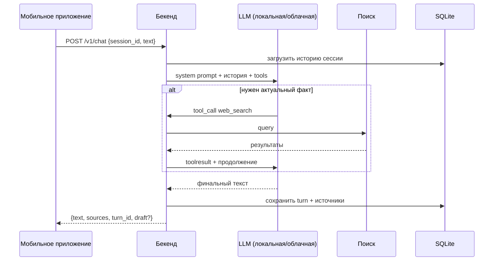
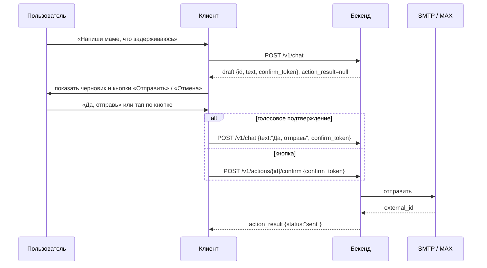

# Руководство для разработчика клиента

Версия API: 1.0 · Файл спецификации: [`docs/openapi.json`](openapi.json) (OpenAPI 3.1)

Этот документ описывает, как подключать мобильное приложение и аудиоколонку к бекенду голосового помощника. Для генерации клиентских SDK используйте `openapi.json`; WebSocket в спецификации описан расширением `x-websocket` на пути `/v1/ws/voice` (стандартные генераторы его игнорируют — читайте раздел ниже вручную).

---

## 1. Быстрые факты

| Параметр | Значение |
|---|---|
| Base URL (локально) | `http://localhost:8000` |
| Base URL (прода) | ваш HTTPS-домен, например `https://api.example.com` |
| HTTP-авторизация | заголовок `X-API-Key: <ключ>` |
| WebSocket-авторизация | query `?token=<ключ>` |
| Основной язык ответов | русский |
| Формат API | JSON (UTF-8) |
| Идентификатор диалога | `session_id`, клиент генерирует и сохраняет его |

Ключ по умолчанию в `.env` — `dev-key`. Для прода используйте отдельные ключи на приложение и храните их в защищённом хранилище, а не в исходниках.

Минимальный запрос:

```bash
curl -H 'X-API-Key: dev-key' -H 'Content-Type: application/json' \
  -d '{"session_id":"phone-123","text":"Сколько варить макароны?"}' \
  http://localhost:8000/v1/chat
```

Ответ содержит `text`, `sources`, `turn_id`, а также опционально `draft` и `action_result`.

---

## 2. Карта эндпоинтов

| Метод | Путь | Что делает | Когда использовать |
|---|---|---|---|
| `POST` | `/v1/chat` | Текстовый turn: LLM + инструменты + поиск | Текстовый ввод, кнопки, подтверждения, отмена |
| `POST` | `/v1/stt` | Аудиофайл → текст | Отдельное распознавание, если клиент сам решает, когда слать |
| `POST` | `/v1/tts` | Текст → аудио | Отдельная озвучка подсказок/кнопок |
| `POST` | `/v1/voice` | Аудиофайл → аудио-ответ | Простой «записал → отправил → получил ответ» |
| `WS` | `/v1/ws/voice` | Потоковый диалог | Живой голосовой UX, колонка |
| `GET` | `/v1/actions/drafts` | Список черновиков сессии | Показать ожидающие отправки |
| `POST` | `/v1/actions/{id}/confirm` | Подтвердить и отправить | Кнопка «Отправить» в UI |
| `POST` | `/v1/actions/{id}/cancel` | Отменить черновик | Кнопка «Отмена» |
| `POST` | `/v1/integrations/max/webhook` | Входящие события MAX | Только бекенд MAX, не мобильный клиент |
| `GET` | `/health`, `/ready` | Проверки | Мониторинг |

Полные схемы запросов/ответов, примеры и коды ответов — в `openapi.json` (или в интерактивной документации `/docs`).

---

## 3. Основные понятия

**Session** — диалог. Клиент создаёт `session_id` сам (например, UUID) и переиспользует его между turn'ами. Бекенд хранит последние 8 реплик и контекст черновиков в этой сессии. Для колонки можно использовать `device_id` в качестве `session_id`.

**Turn** — один обмен: пользовательский текст → ответ ассистента. Возвращается `turn_id`, полезен для аналитики и идемпотентности.

**Draft** — черновик письма/сообщения. Создаётся инструментом ассистента, но **не отправляется**. Имеет статус `pending`, TTL (по умолчанию 10 минут) и одноразовый `confirm_token`.

**Action result** — результат уже выполненной отправки (`sent`) или отмены.

Важное правило: ассистент никогда не считает действие выполненным без вызова подтверждения. Если в ответе есть `draft` и нет `action_result`, значит сообщение **не отправлено**.

---

## 4. Жизненный цикл обычного запроса



### Пример: поиск

```bash
curl -H 'X-API-Key: dev-key' -H 'Content-Type: application/json' \
  -d '{"session_id":"phone-123","text":"Как убрать нагар с кастрюли?"}' \
  http://localhost:8000/v1/chat
```

В `sources` будут ссылки с заголовками и фрагментами — отображайте их в UI как «Источники». В тексте ответа могут встречаться ссылки вида `[1]`, `[2]`.

---

## 5. Двухфазная отправка (обязательное подтверждение)



### Что должен делать клиент

1. Если в ответе есть `draft` — сохраните `draft.id` и `confirm_token` в памяти сессии и покажите пользователю текст черновика.
2. Пока не получен `action_result.status == "sent"`, не показывайте статус «Отправлено».
3. Для кнопки вызовите `POST /v1/actions/{id}/confirm` с токеном.
4. Для голосового подтверждения отправьте новый `/v1/chat` с текстом «Да, отправь» и тем же `confirm_token`. Бекенд также допускает явное подтверждение в рамках активной сессии без токена, но передавать токен рекомендуется.
5. При `409` покажите «Черновик уже отправлен/отменён/истёк» и обновите список черновиков через `GET /v1/actions/drafts`.
6. `confirm_token` одноразовый. После успешной отправки он больше не действует.

Пример подтверждения кнопкой:

```bash
curl -H 'X-API-Key: dev-key' -H 'Content-Type: application/json' \
  -d '{"confirm_token":"<из ответа draft>"}' \
  http://localhost:8000/v1/actions/draft_xxx/confirm
```

Получатели берутся только из whitelist `CONTACTS_JSON` на сервере. Если пользователь просит написать неизвестному контакту, ассистент отвечает, что получатель не найден. Управлять списком контактов должен администратор сервера, не клиент.

---

## 6. REST-аудио: простой сценарий

### `POST /v1/voice`

Принимает `multipart/form-data`: `file` (любой формат, который понимает ffmpeg: webm/opus, m4a, mp3, wav) и `session_id`. Возвращает аудио-файл ответа и заголовки:

| Заголовок | Содержание |
|---|---|
| `X-Transcript` | URL-encoded распознанный текст |
| `X-Assistant-Text` | URL-encoded ответ ассистента |
| `X-Turn-Id` | ID turn |
| `X-Draft-Id` | ID черновика, если создан |
| `X-Confirm-Token` | Токен черновика |

Текстовые заголовки кодируются в UTF-8 с percent-encoding — декодируйте перед показом пользователю.

```bash
curl -H 'X-API-Key: dev-key' -F 'file=@record.webm' -F 'session_id=phone-123' \
  http://localhost:8000/v1/voice --output answer.mp3
```

### Отдельные `STT` и `TTS`

```bash
curl -H 'X-API-Key: dev-key' -F 'file=@record.webm' http://localhost:8000/v1/stt
curl -H 'X-API-Key: dev-key' -H 'Content-Type: application/json' \
  -d '{"text":"Привет!","format":"mp3"}' http://localhost:8000/v1/tts --output answer.mp3
```

`format`: `mp3`, `wav`, `opus`. Для мобильных приложений рекомендуется `mp3` или `opus`, для отладки — `wav`.

---

## 7. WebSocket: живой голосовой диалог

URL: `wss://<host>/v1/ws/voice?session_id=<id>&token=<API_KEY>`

### 7.1 Что отправляет клиент

1. Бинарные кадры: сырой PCM16, **16 kHz, mono, little-endian**, 20–100 мс на кадр. Base64 не нужен.
2. Текстовый кадр finalization:

```json
{"type": "end"}
```

Если у клиента есть токен черновика от предыдущего turn:

```json
{"type": "end", "confirm_token": "<token>"}
```

Отмена текущей записи: `{"type":"cancel"}`.

### 7.2 Что присылает сервер

Событие | Когда | Поля
---|---|---
`status` | смена этапа | `stage`: `listening`, `transcribing`, `thinking`, `tool`, `speaking`, `cancelled`
`transcript` | после распознавания | `text`, `final: true`
`delta` | потоковая генерация текста | `text`
`action_draft` | создан черновик | `draft` (включая `confirm_token`)
`audio` | готов чанк озвучки | `data` (base64), `index` (порядковый номер)
`answer` | финальный текст | `text`, `sources`
`done` | конец turn | `turn_id`
`error` | ошибка | `message`

Порядок типичного turn: `status(listening)` → `status(transcribing)` → `transcript` → `status(thinking)` → `delta...` + `audio...` → `answer` → `done`.

### 7.3 Рекомендованная машина состояний клиента

```text
IDLE → RECORDING → PROCESSING → PLAYING → IDLE
                                   ↓
                          AWAIT_CONFIRMATION → PROCESSING → PLAYING
```

- Во время `RECORDING` показывайте индикатор и кнопку «Отмена».
- На `transcript` покажите распознанный текст — пользователь видит, что его услышали.
- На `action_draft` сохраните токен и перейдите в `AWAIT_CONFIRMATION`; озвучьте вопрос «Подтверждаете отправку?».
- На `audio` кладите чанки в очередь воспроизведения по `index`; не начинайте следующий turn, пока очередь не опустеет (если только пользователь не прервал).
- На `error` покажите сообщение и вернитесь в `IDLE`.

### 7.4 Пример: TypeScript / браузер или React Native

```ts
type ClientEvent =
  | { type: "status"; stage: string }
  | { type: "transcript"; text: string; final: boolean }
  | { type: "delta"; text: string }
  | { type: "action_draft"; draft: { id: string; confirm_token: string; text: string } }
  | { type: "audio"; data: string; index: number }
  | { type: "answer"; text: string; sources: unknown[] }
  | { type: "done"; turn_id: string }
  | { type: "error"; message: string };

const ws = new WebSocket(
  `wss://api.example.com/v1/ws/voice?session_id=${sessionId}&token=${apiKey}`
);
let savedConfirmToken: string | undefined;

ws.onmessage = (e) => {
  const event = JSON.parse(e.data) as ClientEvent;
  switch (event.type) {
    case "transcript":
      setStatus(`Распознано: ${event.text}`);
      break;
    case "delta":
      appendAnswer(event.text);
      break;
    case "action_draft":
      savedConfirmToken = event.draft.confirm_token;
      showDraft(event.draft);
      break;
    case "audio":
      enqueueAudio(base64ToBytes(event.data), event.index);
      break;
    case "done":
      setStatus("Готово");
      break;
    case "error":
      showError(event.message);
      break;
  }
};

// PCM16 16 kHz mono, 20 мс = 640 байт
function sendChunk(pcm: ArrayBuffer) {
  ws.send(pcm);
}

function finishTurn() {
  ws.send(JSON.stringify({
    type: "end",
    ...(savedConfirmToken ? { confirm_token: savedConfirmToken } : {}),
  }));
}
```

### 7.5 Пример: Kotlin / Android (OkHttp, упрощённо)

```kotlin
val client = OkHttpClient()
val request = Request.Builder()
    .url("wss://api.example.com/v1/ws/voice?session_id=$sessionId&token=$apiKey")
    .build()

val ws = client.newWebSocket(request, object : WebSocketListener() {
    override fun onMessage(webSocket: WebSocket, text: String) {
        val event = JSONObject(text)
        when (event.getString("type")) {
            "transcript" -> runOnUiThread { showTranscript(event.getString("text")) }
            "delta" -> runOnUiThread { appendAnswer(event.getString("text")) }
            "action_draft" -> {
                val draft = event.getJSONObject("draft")
                savedConfirmToken = draft.getString("confirm_token")
                runOnUiThread { showDraft(draft) }
            }
            "audio" -> audioQueue.add(Base64.decode(event.getString("data"), Base64.DEFAULT))
            "done" -> runOnUiThread { onTurnDone() }
            "error" -> runOnUiThread { showError(event.getString("message")) }
        }
    }
})

fun sendPcmChunk(pcm: ByteArray) {
    ws.send(ByteString.of(*pcm))   // бинарный кадр
}

fun finishTurn(confirmToken: String? = null) {
    val json = JSONObject().put("type", "end")
    confirmToken?.let { json.put("confirm_token", it) }
    ws.send(json.toString())
}
```

### 7.6 Аудиоколонка

Для колонки используется тот же контракт. На устройстве реализуйте wake word и VAD; бекенд о них не знает. Передавайте стабильный `device_id` в `session_id`, чтобы сохранялся контекст диалога. Рекомендуется буферизовать PCM-чанки по 20–40 мс и отправлять их по мере записи, а `end` — после детекции тишины.

---

## 8. Ошибки и повторные запросы

| HTTP | Значение | Что делать клиенту |
|---|---|---|
| `401` | Неверный/отсутствующий API-ключ | Проверить ключ и заголовок/query |
| `404` | Черновик не найден | Обновить список черновиков |
| `409` | Черновик отправлен/отменён/истёк, неверный токен | Показать актуальный статус, не повторять отправку вслепую |
| `422` | Ошибка валидации | Проверить тело запроса |
| `429` | Превышен лимит (по умолчанию 30 запросов/мин на сессию) | Подождать и повторить с backoff |
| `502` | Все LLM/STT/TTS-провайдеры недоступны | Показать «сервис временно недоступен» |
| `503` | SMTP/MAX недоступен | Черновик остаётся в статусе `failed`, можно повторить подтверждение |

Для `POST /v1/chat` поддерживается заголовок `Idempotency-Key`: повтор запроса с тем же ключом вернёт сохранённый ответ и не создаст новый turn. Используйте его при нестабильной сети.

Для отправки идемпотентность обеспечивается сервером по `draft_id` — повторный `confirm` не приведёт к второй отправке.

---

## 9. Разработка и тестовые данные

Чтобы поднять стек без ключей и GPU:

```bash
cp .env.example .env
docker compose up --build
```

В этом режиме:
- LLM отвечает детерминированно (`LLM_PROVIDERS` с типом `mock`);
- STT возвращает текст из `STT_MOCK_TEXT`;
- TTS отдаёт короткий тестовый WAV;
- поиск возвращает два примера результатов;
- почта и MAX не делают реальных отправок (`EMAIL_TRANSPORT=mock`, `MAX_TRANSPORT=mock`).

Полезные тестовые фразы для mock-LLM:

| Фраза | Поведение |
|---|---|
| «Сколько варить макароны?» | вызов `web_search`, ответ с источниками `[1]`, `[2]` |
| «Напиши маме что задерживаюсь» | создание черновика `email` |
| «Отправь ребенку сообщение что задерживаюсь» | создание черновика `max` |
| «Да, отправь» | подтверждение последнего черновика |
| «Отмени» | отмена черновика |

Переключение на реальные провайдеры — только через `.env`; код клиента не меняется.

---

## 10. Перегенерация OpenAPI

Спецификация генерируется из FastAPI-приложения и дополняется расширениями (`securitySchemes`, `servers`, `x-websocket`) в `app/openapi.py`.

```bash
python - <<'PY'
import json
from app.main import app
with open("docs/openapi.json", "w", encoding="utf-8") as f:
    json.dump(app.openapi(), f, ensure_ascii=False, indent=2)
    f.write("\n")
PY
```

Интерактивная документация доступна по `/docs` и `/redoc`, сырая спецификация — по `/openapi.json`.

---

## 11. Чек-лист перед релизом клиента

- [ ] Используется HTTPS/WSS, API-ключ не зашит в APK/IPA.
- [ ] `session_id` сохраняется между запусками приложения.
- [ ] Клиент показывает распознанный текст по событию `transcript`.
- [ ] `confirm_token` сохраняется из `action_draft` и передаётся на следующем turn/в кнопке подтверждения.
- [ ] До получения `action_result.status == "sent"` не отображается «Отправлено».
- [ ] Обработаны `409`, `429`, `502`, `503` и обрыв WebSocket (переподключение с повторной инициализацией сессии).
- [ ] Аудио для WS — PCM16 16 kHz mono; для REST — любой формат, поддерживаемый ffmpeg.
- [ ] Включено логирование `turn_id` для поддержки.
- [ ] Для колонки реализованы wake word/VAD на устройстве и стабильный `device_id`.
